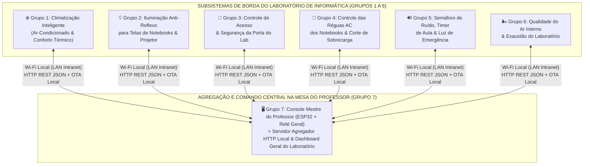

# 📋 Avaliação Somativa — Parte 1: Contexto Geral, Divisão dos 7 Grupos e Planejamento da Automação

> **Curso:** Técnico em Desenvolvimento de Sistemas — SENAI-SP  
> **Unidade Curricular:** Internet das Coisas (Carga Horária: 75h)  
> **Referência do Plano de Ensino:** Item E — Definição da Situação de Avaliação Somativa (Etapa de Planejamento e Arquitetura)  
> **Docente Responsável:** Irineu Francisco de Souza

---

## 💻 1\. Contextualização da Situação-Problema

### **Contexto Profissional:**

A coordenação pedagógica e de infraestrutura do SENAI contratou a sua turma — atuando como uma equipe de **Engenharia de Sistemas Embarcados e IoT** — para planejar, projetar e implantar o sistema de **Automação, Eficiência Energética e Supervisão Centralizada do Laboratório de Informática (*Smart Computer Lab*)**.

Nosso **Laboratório de Informática** possui características e desafios reais de operação diária:

1. Os alunos utilizam **notebooks conectados a réguas de tomadas AC** nas bancadas, que precisam de controle de potência, proteção térmica e desligamento programado ao fim da aula para evitar sobrecarga elétrica, aquecimento das fontes e desgaste prematuro das baterias;  
2. O ambiente fechado com mais de 30 pessoas e dezenas de notebooks dissipando calor exige controle inteligente de **climatização (ar-condicionado)** e de **renovação/qualidade do ar interno**;  
3. A **iluminação** precisa ser setorizada para evitar reflexo nas telas dos notebooks e não ofuscar o projetor multimídia durante as explicações na lousa;  
4. O laboratório requer **controle de acesso na porta**, **monitoramento acústico (semáforo de ruído) com luz de emergência** e um **Painel Supervisório Geral** na mesa do professor capaz de agregar todas as soluções da sala em uma única tela\!

---

## 🔒 2\. Premissa Obrigatória: Arquitetura 100% em Rede Local (Zero Internet)

Por requisitos de **segurança cibernética, soberania de dados e alta disponibilidade**, **TODO O SISTEMA DEVE FUNCIONAR 100% EM REDE LOCAL (LAN/Intranet) E COM ACIONAMENTO POR MÓDULO RELÉ LOCAL — NADA NA INTERNET\!**

Mesmo que o link de internet da escola esteja desconectado, toda a automação do **Laboratório de Informática** deve operar normalmente em três camadas locais:

1. **Camada de Borda (*Edge Computing* no ESP32):** Cada **ESP32** lê os sensores da sua bancada e aciona seu **Módulo Relé físico localmente (`GPIO 26`)** de forma autônoma (caso o servidor seja desligado, as travas de segurança e o controle local continuam funcionando).  
2. **Camada de Servidor Local (*Backend On-Premises*):** A comunicação ocorre exclusivamente dentro do Wi-Fi local do laboratório via **HTTP/REST Local (`Node.js / Express` na porta `3000`)**, trocando pacotes estruturados em **JSON**.  
3. **Camada de Supervisão Local (*Front-End Web* e *OTA*):** Os Dashboards individuais (Grupos 1 a 6\) e o **Dashboard Geral Agregador (Grupo 7\)** rodam localmente no navegador (`HTML5 + CSS3 + JS + Chart.js`), e o ESP32 suporta atualização remota de firmware via rede local (**OTA Local**).



&nbsp;

---

## 🛠️ 3\. Divisão dos 7 Grupos: Temas e Requisitos de Cada Automação

A turma será dividida em **7 Grupos**. Os **Grupos 1 a 6** serão responsáveis pelos subsistemas físicos de automação do laboratório, enquanto o **Grupo 7** será responsável pelo Console Mestre do Professor e pela **agregação de todas as soluções em um Dashboard Geral Único**:

---

### ❄️ GRUPO 1: Climatização Inteligente do Laboratório de Informática (*Smart Lab HVAC*)

* **Problema Real no Lab:** 30 notebooks e fontes ligados simultaneamente mais 30 alunos geram alta carga térmica. Porém, o ar-condicionado muitas vezes fica ligado com a porta/janela aberta ou permanece funcionando após a turma sair do laboratório.  
* **Sensores e Entradas no ESP32:**  
  * Sensor **DHT11/DHT22** (Temperatura em °C e Umidade Relativa em % do Laboratório).  
  * Botão / Chave simulando o **Sensor de Porta/Janela Fechada**.  
  * Potenciômetro no ADC (`GPIO 34`) ou controle no Dashboard Local para definir o *Setpoint* desejado (ex.: `22 °C`).  
* **Atuadores Locais no ESP32:**  
  * **Módulo Relé Local (`GPIO 26`)** acionando o Contator do Ar-Condicionado \+ **LEDs de Status**.  
* **Regras Obrigatórias da Automação:**  
  1. Acionar o **Relé Local** automaticamente quando `Temperatura > Setpoint` **E** a porta/janela estiver fechada.  
  2. **Intertravamento de Economia:** Se a porta/janela ficar aberta, o ESP32 desliga o relé imediatamente e envia alerta para o Dashboard Local (*"Bloqueio Térmico: Porta/Janela Aberta"*).  
  3. Permitir comando manual remoto pelo Dashboard Local via HTTP (`LIGAR` / `PARAR` / alterar *Setpoint*).

---

### 💡 GRUPO 2: Iluminação Setorizada Anti-Reflexo para Notebooks (*Smart Notebook Lighting*)

* **Problema Real no Lab:** A luz excessiva próxima às janelas causa reflexo nas telas dos notebooks, prejudicando a visão dos alunos, enquanto a fileira de luzes da frente ofusca o projetor durante a explicação do professor.  
* **Sensores e Entradas no ESP32:**  
  * Sensor **LDR (Fotoresistor)** no ADC (`GPIO 34`) medindo a luminosidade natural incidente nas bancadas (`0% a 100%`).  
  * Sensor **DHT11/DHT22** (monitoramento ambiental do setor de bancadas).  
  * Botão físico local de alternância de cena (*Modo Programação* / *Modo Projetor* / *Desligado*).  
* **Atuadores Locais no ESP32:**  
  * **Módulo Relé Local (`GPIO 26`)** controlando o circuito geral de iluminação das bancadas \+ **LEDs de Setor** (Setor Janela / Setor Lousa).  
* **Regras Obrigatórias da Automação:**  
  1. **Compensação de Luz Natural:** Se a claridade natural medida pelo `LDR` já for suficiente (`> 75%`), desarmar o relé do circuito de iluminação complementar para economizar energia.  
  2. **Cena "Modo Explicação no Projetor":** Acionável tanto pelo botão físico local quanto pelo Dashboard Web Local, ajustando imediatamente a iluminação frontal para não ofuscar a projeção nem as telas dos notebooks.  
  3. Exibir no Dashboard Local o gráfico de luminosidade (%) e o estado atual do Relé de Iluminação.

---

### 🔐 GRUPO 3: Controle de Acesso e Segurança Patrimonial do Laboratório (*Lab Access & Security*)

* **Problema Real no Lab:** Por conter dezenas de notebooks, fontes e kits IoT, a porta do laboratório deve possuir fechadura controlada localmente, registro de horários de abertura e alarme contra abertura não autorizada no intervalo ou fora do horário de aula.  
* **Sensores e Entradas no ESP32:**  
  * Botão de **Botoeira Interna de Saída** \+ Chave/Sensor de **Porta Aberta/Fechada**.  
  * Sensor **DHT11/DHT22** monitorando o hall de entrada do laboratório.  
* **Atuadores Locais no ESP32:**  
  * **Módulo Relé Local (`GPIO 26`)** acionando a **Fechadura Eletromagnética da Porta**.  
  * **Buzzer / LED Vermelho de Alarme** para intrusão ou porta mantida aberta além do tempo limite.  
* **Regras Obrigatórias da Automação:**  
  1. **Destravamento Temporizado por Relé:** Ao receber autorização (pela botoeira local ou pelo botão *"Liberar Porta"* no Dashboard Local), acionar o **Relé da Fechadura** por `5 segundos` e voltar a trancar automaticamente.  
  2. **Alarme de Porta Esquecida Aberta ou Intrusão:** Se o laboratório estiver no modo *"Trancado/Armado"* (intervalo ou fim de expediente) e o sensor detectar abertura, disparar o alarme local e destacar o evento em vermelho no Dashboard Local.  
  3. Armazenar no servidor Node.js local o **Log de Auditoria de Acessos** com horário exato de cada abertura.

---

### 🔌 GRUPO 4: Gestão Inteligente das Réguas AC de Energia dos Notebooks (*Smart AC Power Strips*)

* **Problema Real no Lab:** Os computadores do laboratório são **notebooks ligados em réguas de tomadas AC** nas bancadas. Manter as réguas de tomadas energizadas 24h por dia aquece as fontes, desgasta a vida útil das baterias dos notebooks, gera risco de sobrecarga elétrica quando muitos carregadores são plugados simultaneamente e desperdiça energia após o término da aula.  
* **Sensores e Entradas no ESP32:**  
  * **Potenciômetro no ADC (`GPIO 34`)** simulando a **Potência Consumida (Watts)** pelas fontes dos notebooks conectadas às réguas AC (ex.: de `0 W` a `2500 W`).  
  * Sensor **DHT11/DHT22** medindo o **Aquecimento das Réguas de Tomadas AC / Canaleta da Bancada**.  
  * **Botão Físico Local (`BOOT` / `GPIO 0`)** atuando como **Botão de Corte Rápido / Emergência das Réguas AC**.  
* **Atuadores Locais no ESP32:**  
  * **Módulo Relé Local (`GPIO 26`)** energizando ou cortando a alimentação das **Réguas de Tomadas AC das Bancadas de Notebooks**.  
* **Regras Obrigatórias da Automação:**  
  1. **Proteção Autônoma Contra Sobrecarga e Aquecimento na Régua AC:** Se a potência consumida nas réguas ultrapassar o limite seguro (`> 90%`) **OU** a temperatura da régua AC subir além do limite (`>= 40 °C`), o ESP32 desarma o **Relé Local das Réguas AC** imediatamente para proteger as fontes e os notebooks\!  
  2. **Ciclo Inteligente de Recarga / Corte Pós-Aula:** Permitir ligar/desligar as réguas AC remotamente pelo Dashboard Local e ativar o *"Modo Proteção de Bateria / Fim de Aula"*.  
  3. Exibir no Dashboard Local o gráfico em tempo real de Potência nas Réguas AC (Watts) vs. Temperatura (°C).

---

### 🔊 GRUPO 5: Conforto Acústico (Semáforo de Ruído), Timer de Aula e Luz de Emergência (*Smart Acoustic & Emergency*)

* **Problema Real no Lab:** Durante as aulas práticas em grupo, o nível de ruído pode subir muito e prejudicar a concentração na programação. Além disso, o laboratório precisa de um sinalizador de tempo de atividades (*Sprints*/intervalo) e de **Iluminação de Emergência Autônoma** caso falte luz na sala.  
* **Sensores e Entradas no ESP32:**  
  * Sensor de Som **KY-037/KY-038** ou **Potenciômetro no ADC (`GPIO 34`)** calibrado para medir o **Nível de Ruído da Sala em Decibéis (`40 dB a 100 dB`)**.  
  * Sensor **LDR** (ou botão de teste) para detectar **Queda Total de Energia/Escuridão Repentina** no laboratório.  
  * Sensor **DHT11/DHT22** para correlação de conforto ambiental da turma.  
* **Atuadores Locais no ESP32:**  
  * **Módulo Relé Local (`GPIO 26`)** acionando a **Luminária de Emergência / Sinalizador Mestre da Sala**.  
  * **Semáforo Acústico Físico (LEDs Verde, Amarelo e Vermelho)** indicando em tempo real o nível de silêncio/foco do laboratório.  
* **Regras Obrigatórias da Automação:**  
  1. **Semáforo Acústico por Modo de Aula:** Atualizar os LEDs e o Dashboard conforme o modo selecionado pelo professor: *Modo Foco/Avaliação* (limite `55 dB`), *Modo Programação Prática* (limite `70 dB`) ou *Modo Debate em Grupo* (limite `80 dB`).  
  2. **Acionamento Autônomo do Relé de Emergência:** Se for detectada escuridão súbita (queda de luz na sala) **OU** alerta de evacuação, atracar imediatamente o **Relé Local da Iluminação/Sinalização de Emergência**.  
  3. Exibir no Dashboard Local o gráfico histórico de Decibéis (`dB`) e os botões para selecionar o Modo da Aula.

---

### 🌬️ GRUPO 6: Qualidade do Ar Interno, Exaustão e Conforto Respiratório (*Lab Air Quality & Exhaust*)

* **Problema Real no Lab:** Como o laboratório permanece fechado por horas para manter o ar-condicionado, a respiração de 32 pessoas satura o ambiente com gás carbônico ($\text{CO}_2$) e umidade, causando sonolência, dor de cabeça e queda de atenção.  
* **Sensores e Entradas no ESP32:**  
  * Sensor de Qualidade do Ar **MQ-135** (ou **Potenciômetro no ADC `GPIO 34`** calibrado para concentração de **$\text{CO}_2$ de `400 ppm a 2500 ppm`**).  
  * Sensor **DHT11/DHT22** (Temperatura e Umidade Relativa do ar do laboratório).  
* **Atuadores Locais no ESP32:**  
  * **Módulo Relé Local (`GPIO 26`)** acionando o **Motor de Renovação de Ar / Exaustor do Laboratório**.  
  * **LEDs Indicadores de Qualidade do Ar** (Verde \= Ar Puro, Amarelo \= Atenção, Vermelho \= Ar Saturado / Exaustor Ligado).  
* **Regras Obrigatórias da Automação:**  
  1. **Controle Autônomo de Renovação de Ar:** Quando o índice de $\text{CO}_2$ ultrapassar `1000 ppm` (ou a umidade sair da faixa saudável), o ESP32 atraca automaticamente o **Relé Local do Exaustor** até o ar retornar a `< 800 ppm`.  
  2. Exibir no Dashboard Local a curva histórica de Qualidade do Ar (`ppm`) e Umidade (`%`).  
  3. Permitir ao professor ligar/desligar a renovação de ar manualmente tanto pelo botão físico na bancada quanto pelo Dashboard Local.

---

### 🖥️ GRUPO 7: Central Supervisória Agregadora (Dashboard Geral do Laboratório & Console Mestre do Professor)

* **Problema Real no Lab:** O professor precisa de **1 (um) Painel Supervisório Geral Único** que agregue em tempo real os dados dos **Grupos 1 a 6** na rede local, além de um **Console Físico Mestre na Mesa do Professor** capaz de iniciar ou encerrar todo o laboratório com um único comando\!  
* **Hardware Físico do Grupo 7 (Console Mestre na Mesa do Professor):**  
  * **ESP32 Mestre do Professor** com Sensor **DHT11/DHT22** e **LDR** (medindo o clima e a luz de referência na mesa do instrutor).  
  * **Botão Físico de "Chave Geral da Aula" (`GPIO 0` / Botão Externo):** Alterna o laboratório inteiro entre **"MODO AULA ATIVA"** e **"LABORATÓRIO ENCERRADO (TUDO DESLIGADO)"**.  
  * **Módulo Relé Local (`GPIO 26`):** Aciona a **Alimentação da Mesa do Professor e Alerta Geral do Laboratório**.  
* **Regras Obrigatórias de Agregação e Automação Local (Grupo 7):**  
  1. **Servidor Agregador na LAN (`server.js`):** Receber na rota `POST /api/telemetria` os pacotes JSON dos **Grupos 1 a 7** e disponibilizar a rota `GET /api/status-geral` para o **Dashboard Geral do Laboratório**.  
  2. **Dashboard Geral Único (`HTML5/CSS3/JS + Chart.js`):** Exibir em uma única tela executiva os **7 Cards de Status ao Vivo** (Grupos 1 a 7), o diagnóstico de quais bancadas estão **ONLINE/OFFLINE** na rede local, o gráfico comparativo (`height: 220px`) e o **Índice Global de Eficiência do Laboratório (`0% a 100%`)**.  
  3. **Comando Mestre em Lote (*Macro "Iniciar Aula" e "Encerrar Laboratório"*):** Ao clicar no botão **"⏹ ENCERRAR LABORATÓRIO (DESLIGAR TUDO)"** no Dashboard Geral (ou apertar o botão físico no ESP32 do Grupo 7), o servidor agenda o comando `PARAR` para desligar simultaneamente o Ar-Condicionado (G1), a Iluminação (G2), trancar a Porta (G3), cortar a energia das Réguas AC dos Notebooks (G4) e desligar o Exaustor (G6)\!

---

## 🔗 4\. Contrato Padrão de Dados JSON na Rede Local (Todos os Grupos)

Para garantir que os **Grupos 1 a 6** consigam enviar seus dados para o **Servidor Agregador do Grupo 7**, todos os grupos deverão estruturar seu `HTTP POST /api/telemetria` com os seguintes campos padronizados:

```json
{
  "grupo_id": "grupo_04",
  "nome_subsistema": "Reguas_AC_Notebooks",
  "ip_local": "192.168.0.104",
  "mac_address": "24:6F:28:AA:BB:CC",
  "temperatura": 31.5,
  "umidade": 54.0,
  "variavel_principal_nome": "Potencia_Reguas_W",
  "variavel_principal_valor": 1450.0,
  "rele_ativo": true,
  "status_alerta": "NORMAL"
}
```

* **Resposta HTTP do Servidor (`201 Created`):**

```json
{
  "status": "sucesso",
  "comando": "NENHUM"
}
```

  *(Onde `"comando"` pode assumir `"LIGAR"`, `"PARAR"` ou `"NENHUM"`, permitindo que o ESP32 acione ou desligue seu Módulo Relé Local imediatamente ao receber a resposta do `POST`\!).*

---

## 📐 5\. Entregável Inicial: Documento de Planejamento da Automação

Antes de iniciar a codificação da **Sprint 1**, cada grupo deverá elaborar e entregar o seu **Documento de Planejamento da Automação do Laboratório de Informática**, contendo obrigatoriamente os **6 tópicos abaixo**:

1. **Identificação e Escopo:** Nome do Grupo, Integrantes, Subsistema atribuído (Grupo 1 a 7\) e descrição do problema real que ele soluciona no Laboratório de Informática.  
2. **Mapa de Hardware e Pinagem (`Pinout` do ESP32):** Tabela listando cada sensor de entrada, o **Módulo Relé Local (`GPIO 26`)** e LEDs/botões, indicando o pino exato do ESP32, tensão (`3.3V` ou `5V`/`VIN`) e tipo de sinal (Digital ou Analógico ADC de 12 bits `0–4095`).  
3. **Tabela de Regras de Negócio e Limiares (*Thresholds*):**  
   * Quais valores exatos dos sensores definem o estado `NORMAL` (Verde), `ATENÇÃO` (Amarelo) e `CRÍTICO` (Vermelho)?  
   * Em qual condição o **Relé Local** liga ou desliga sozinho na borda (*modo automático*) e como ele responde ao comando manual do Dashboard?  
4. **Diagrama de Rede Local e Contrato JSON:** Esquema mostrando o fluxo `ESP32 ➔ Roteador Wi-Fi Local ➔ Servidor Node.js (Porta 3000) ➔ Dashboard HTML` e o exemplo preenchido do JSON do grupo.  
5. **Esboço (*Wireframe*) da Tela do Dashboard:** Rascunho visual mostrando os cartões de KPIs do grupo, o gráfico temporal compacto (`220px`) e os botões de comando remoto do relé.  
6. **Divisão de Tarefas da Equipe (Kanban):** Quem do grupo ficará responsável pela montagem física/ESP32, quem cuidará do servidor Node.js e quem desenvolverá o Front-End do Dashboard.